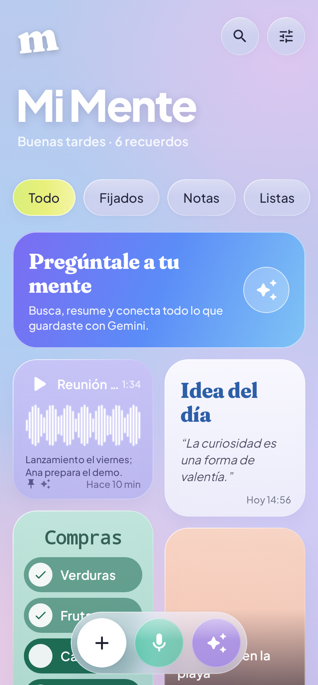
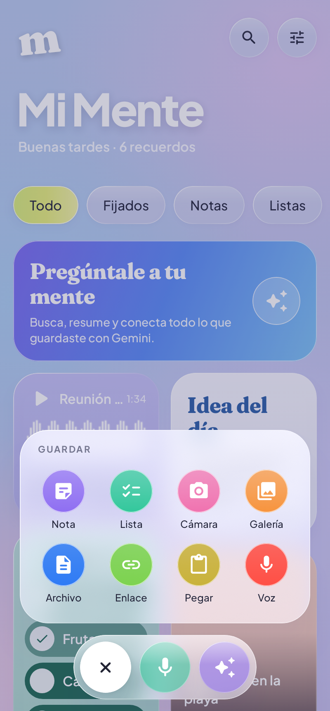
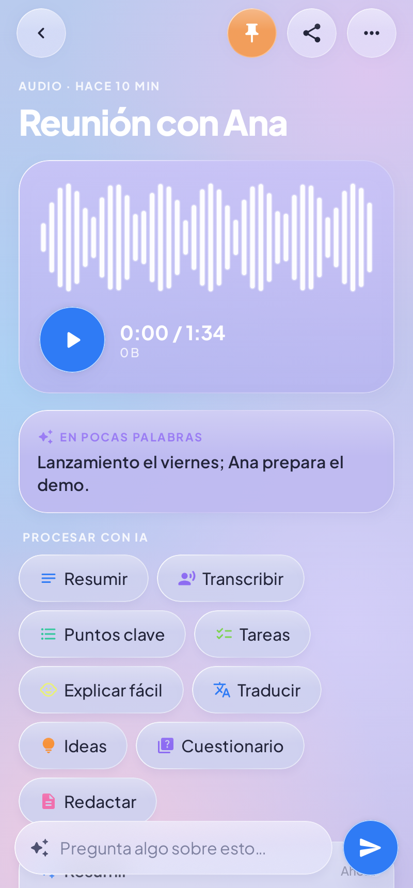
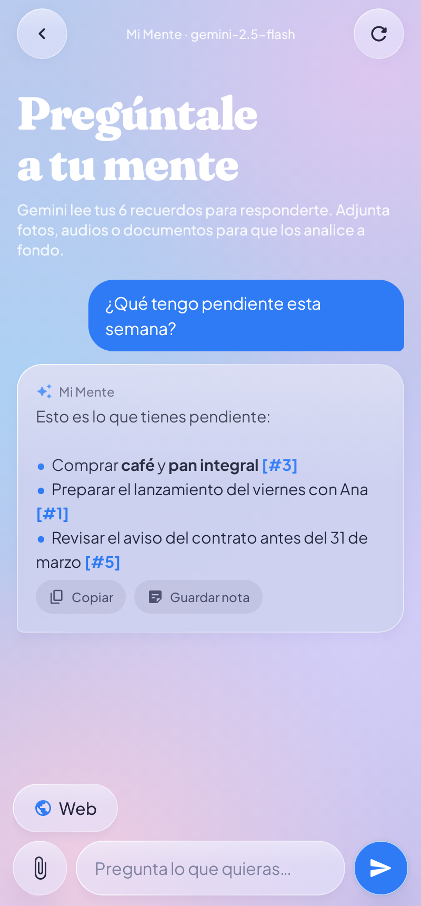

# Mi Mente

Tu segundo cerebro para Android: guarda al instante notas, listas, fotos, audios, videos, documentos y enlaces, y procésalos con **Gemini** usando tu clave de **Google AI Studio**. La interfaz es de vidrio líquido, inspirada en el diseño de [Artefact](https://github.com/Chethan616/Artefact).

| Inicio | Capturar | Detalle con IA | Pregúntale a tu mente |
|---|---|---|---|
|  |  |  |  |

## Qué hace

- **Captura rápida** desde el botón ＋: nota, lista, cámara, galería, archivo, enlace, pegar del portapapeles o voz.
- **Compartir hacia Mi Mente** desde cualquier app (WhatsApp, Chrome, Gmail, Archivos…): texto, enlaces, fotos, audios, videos, PDF y documentos.
- **Accesos directos** (mantén pulsado el icono): Nueva nota, Grabar idea, Foto rápida, Preguntar a mi mente.
- **Procesado automático al guardar**: título, resumen de una línea, transcripción de audios y videos, y texto visible en fotos.
- **Acciones de IA de un toque** sobre cada elemento: Resumir, Transcribir, Describir, Extraer texto, Puntos clave, Tareas (se convierten en lista), Explicar fácil, Traducir, Ideas, Cuestionario y Redactar. También puedes hacer preguntas libres.
- **Pregúntale a tu mente**: un chat que lee todo lo que guardaste y cita las fuentes con referencias [#n] que puedes tocar. Admite adjuntos y búsqueda web opcional (Google Search).
- Búsqueda, filtros, elementos fijados, tema claro y oscuro, intensidad del vidrio ajustable, vibración háptica, y copias de seguridad en .zip para exportar e importar.

### Formatos

| Tipo | Cómo lo lee la IA |
|---|---|
| Imágenes (JPG, PNG, WEBP, HEIC, GIF…) | Reducidas a JPEG de 2048 px |
| Audio (AAC, MP3, WAV, OGG, FLAC, M4A) y video (MP4, MOV, WEBM…) | Nativo; los archivos de más de 14 MB se suben a la File API de Gemini |
| PDF | Nativo, con texto e imágenes |
| Word, Excel, PowerPoint y OpenDocument | Se extrae el texto en el teléfono |
| Texto, Markdown, CSV, JSON y código | Texto directo |
| Enlaces | Herramienta `url_context`; los videos de YouTube se analizan directamente |

## Configurar la IA

1. Crea una clave gratuita en https://aistudio.google.com/apikey
2. En la app, abre **Ajustes → Google AI Studio**, pégala y pulsa **Guardar y probar**.
3. Elige el modelo (por defecto `gemini-2.5-flash`). Al probar la clave se cargan todos los modelos disponibles en tu cuenta.

La clave y tus datos se guardan solo en el teléfono. A Google solo se envía lo que procesas con IA.

## Compilar

Requisitos: JDK 17 o superior y el SDK de Android (plataforma 36).

```bash
./gradlew assembleRelease        # APK en app/build/outputs/apk/release/
./gradlew testDebugUnitTest      # regenera las capturas en screenshots/
```

El APK de release está firmado con la clave de depuración para poder instalarlo directamente. Para publicarlo en Play Store, configura tu propia keystore en `app/build.gradle.kts`.

## Estructura

```
app/src/main/java/com/mimente/app/
├── MainActivity.kt        entrada, contenido compartido, accesos directos
├── Nav.kt                 navegación
├── data/                  modelo, almacenamiento JSON, ajustes, importación y copias
├── ai/                    cliente REST de Gemini, construcción de contenido y acciones
├── media/                 grabadora y reproductor
└── ui/
    ├── theme/             colores Candy, tonos de tarjeta, tipografía
    ├── glass/             vidrio líquido (Haze), resortes y hápticos
    ├── home/              escritorio de tarjetas, dock, menú de captura y grabadora
    ├── item/              detalle con acciones de IA
    ├── edit/              editor de notas, listas y enlaces
    ├── ask/               chat «Pregúntale a tu mente»
    └── settings/          ajustes
```

## Créditos

- Lenguaje visual inspirado en Artefact (Chethan616), con licencia MIT / Apache-2.0. No se copió su código.
- Desenfoque de fondo con [Haze](https://github.com/chrisbanes/haze) (Apache-2.0).
- Tipografías Plus Jakarta Sans y Fraunces (SIL Open Font License).
